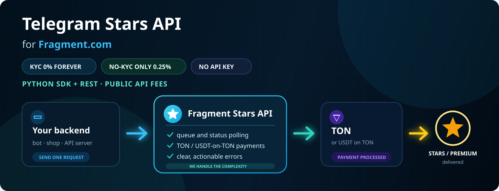

# Telegram Stars & Premium API for Fragment

## KYC 0% · NO-KYC 0.25%

Buy Telegram Stars and gift Premium from a Telegram bot, shop, or reseller backend. Use the Python SDK or direct REST with TON and USDT on TON. **No API key needed.**

**Current SDK: `v2.1.8`** · **Endpoint:** `https://api.fragment-api.space`

[](https://pypi.org/project/fragment-stars-api/)
[](https://pypi.org/project/fragment-stars-api/)
[](https://github.com/bbbuilt/fragment-stars-api/blob/main/LICENSE)

**[Python quick start](#quick-start) · [Direct REST](https://github.com/bbbuilt/fragment-stars-api/blob/main/docs/rest-api.md) · [Build a shop](https://github.com/bbbuilt/fragment-stars-api/blob/main/docs/telegram-stars-shop.md) · [Русский](https://github.com/bbbuilt/fragment-stars-api/blob/main/README.ru.md)**

### Try It Without a Wallet

Read current prices and API fees. These requests need no seed, cookies, or token and do not create a purchase:

```bash
curl https://api.fragment-api.space/api/v1/prices
curl https://api.fragment-api.space/api/v1/commission/rates
```

KYC has **0% API commission permanently**; no-KYC has **0.25% API commission**. Stars/Premium cost and blockchain fees are separate. [Compare modes and payment methods](https://github.com/bbbuilt/fragment-stars-api/blob/main/docs/no-kyc-vs-kyc.md).

<p align="center">
  
</p>

> **Trust boundary:** This is an independent service, not an official Telegram or Fragment API. This repository contains the client SDK, documentation, and examples, not the hosted backend. Purchase requests send your wallet seed to the API service for signing; KYC also sends Fragment session data. Base64 is encoding, not encryption. Use a dedicated operating wallet, keep its balance limited, and never put secrets in frontend code or public logs. See [SECURITY.md](https://github.com/bbbuilt/fragment-stars-api/blob/main/SECURITY.md).

## Quick Start

Install on your backend:

```bash
pip install fragment-stars-api
```

Start with a read-only Python request:

```python
from fragment_api import FragmentAPIClient

with FragmentAPIClient() as client:
    print(client.get_prices())
    print(client.get_rates())
```

**The next example makes a real purchase.** Set `FRAGMENT_WALLET_SEED` to your supported seed encoded as Base64 using your backend's secret configuration. Use a real recipient username in place of `@telegram_user`.

```python
import os
from fragment_api import FragmentAPIClient

with FragmentAPIClient() as client:
    accepted = client.buy_stars(
        username="@telegram_user",
        amount=100,
        seed=os.environ["FRAGMENT_WALLET_SEED"],
        payment_method="ton",
        wait=False,
    )
    print(accepted.request_id)  # Persist against your shop order before polling.
```

This is **no-KYC** because cookies are omitted. For KYC, add `cookies=os.environ["FRAGMENT_COOKIES"]`. For Stars paid in USDT on TON, pass `payment_method="usdt_ton"`; keep TON for gas and any due API commission.

For KYC Stars, optionally pass `max_cost="2.96"` alongside `cookies`. It caps the checkout price in the selected currency, excluding network costs. Omit it to keep the original quote as the limit. [REST and limit details](https://github.com/bbbuilt/fragment-stars-api/blob/main/docs/rest-api.md#buy-stars-with-kyc).

Poll `client.get_status(request_id)` until a final state. `queued` and `processing` are not delivery confirmation. With `wait=True` (the default), the SDK polls for you. On a timeout or uncertain payment, reconcile the existing request instead of sending another purchase. [Python integration and recovery](https://github.com/bbbuilt/fragment-stars-api/blob/main/docs/python.md).

## Choose Your Integration

| Build | Start here |
|---|---|
| Python / aiogram / FastAPI bot | [Python SDK guide](https://github.com/bbbuilt/fragment-stars-api/blob/main/docs/python.md) |
| Node.js / TypeScript backend | [Node.js REST guide](https://github.com/bbbuilt/fragment-stars-api/blob/main/docs/nodejs.md) |
| PHP, Go, or another language | [HTTP reference and examples](https://github.com/bbbuilt/fragment-stars-api/blob/main/docs/rest-api.md) |
| Telegram Stars shop | [Minimal backend](https://github.com/bbbuilt/fragment-stars-api/blob/main/examples/shop_minimal.py), [shop checklist](https://github.com/bbbuilt/fragment-stars-api/blob/main/docs/telegram-stars-shop.md), [full example shop](https://github.com/bbbuilt/tg_stars_premium_shop) |
| Telegram Premium gifting | [Premium API guide](https://github.com/bbbuilt/fragment-stars-api/blob/main/docs/telegram-premium-api.md) |
| Codex, Claude, or Cursor integration | [Codex skill](https://github.com/bbbuilt/fragment-stars-api/blob/main/CODEX_SKILL.md) / [Claude skill](https://github.com/bbbuilt/fragment-stars-api/blob/main/CLAUDE_SKILL.md) |

The shop examples are starting points, not a substitute for your checkout authentication, payment verification, or order deduplication.

### Runnable Examples

[KYC/no-KYC and TON/USDT](https://github.com/bbbuilt/fragment-stars-api/blob/main/examples/payment_methods.py) · [Node.js](https://github.com/bbbuilt/fragment-stars-api/blob/main/examples/javascript_fetch.js) · [PHP](https://github.com/bbbuilt/fragment-stars-api/blob/main/examples/php_curl.php) · [Go](https://github.com/bbbuilt/fragment-stars-api/blob/main/examples/go_net_http.go) · [Minimal shop](https://github.com/bbbuilt/fragment-stars-api/blob/main/examples/shop_minimal.py)

## KYC vs No-KYC

| Mode | Fragment cookies | API commission | Payment options |
|---|---|---|---|
| KYC | Your own session | **0% forever** | TON or USDT on TON where supported |
| No-KYC | Not required | **0.25%** | Stars: TON or USDT on TON; Premium: TON |

Omitting `payment_method` keeps TON for existing clients. No-KYC Stars paid in USDT use USDT for the base price and TON for API commission. Commission accumulates per wallet and is collected when debt reaches **1 TON**, not through an extra transfer on every order. The threshold is not an extra fee. [Full comparison and collection rules](https://github.com/bbbuilt/fragment-stars-api/blob/main/docs/no-kyc-vs-kyc.md).

## Wallet Selection

Supported seed formats include a 24-word TON mnemonic, a supported 32-byte key, and a 12-word BIP39 mnemonic for V5R1. Send the complete supported seed as Base64 from your backend.

- `seed` only: a 12-word seed defaults to `account_index=0`; legacy formats keep their wallet selection behavior.
- `seed + account_index`: select a V5R1 account for a 12-word seed.
- `seed + wallet_address`: resolve or verify the wallet; use [the resolver examples](https://github.com/bbbuilt/fragment-stars-api/blob/main/examples/resolve_wallet_index.py) when you do not know its index.
- `seed + wallet_address + account_index`: verify the pairing before purchase.

Use `POST /api/v1/wallet/resolve`, never seed-bearing URL parameters. An address-resolution result is not proof that the wallet has enough funds to buy.

## API Reference

**Base URL:** `https://api.fragment-api.space` — standard HTTPS, port `443`.

| Method | Route | Purpose |
|---|---|---|
| `GET` | `/health` | Availability |
| `GET` | `/api/v1/prices` | Current Stars/Premium prices |
| `GET` | `/api/v1/commission/rates` | API commission rates |
| `POST` | `/api/v1/stars/buy` | Queue a Stars purchase |
| `GET` | `/api/v1/queue/{request_id}` | Read a Stars request's status |
| `POST` | `/api/v1/premium/buy` | Buy 3, 6, or 12 months of Premium |
| `POST` | `/api/v1/premium/check-eligibility` | Check Premium recipient eligibility |
| `POST` | `/api/v1/wallet/resolve` | Resolve or verify a TON wallet account |

No issued token, JWT, OAuth, `Authorization`, or `X-API-Key` is required for client routes. [Full HTTP examples](https://github.com/bbbuilt/fragment-stars-api/blob/main/docs/rest-api.md) · [Website reference](https://fragment-api.space/en/docs/).

Legacy endpoints `https://api-fragment.duckdns.org` and `https://fragment-api.ydns.eu:8443` remain compatible. Existing integrations do not need to migrate immediately.

## Common Client Mistakes

| Problem | Action |
|---|---|
| Fewer than 50 Stars | Validate an integer amount of at least **50** before checkout. |
| Username without `@`, or a channel/bot instead of a user | Pass the intended user's `@telegram_user` username. |
| KYC `need_verify` | Complete the required verification on Fragment with the same account, then update session data if needed. |
| Missing wallet cookie | Connect the matching wallet first; follow the [cookies guide](https://github.com/bbbuilt/fragment-stars-api/blob/main/COOKIES_GUIDE.md). |
| Timeout or uncertain transaction | Keep `request_id`, inspect the status and wallet history; do not auto-repeat the purchase. |
| Rate limit | Respect `Retry-After`; the no-KYC invoice limit is **300 per wallet per hour**, separate from other request limits. |

[All error codes and recovery steps](https://github.com/bbbuilt/fragment-stars-api/blob/main/docs/errors.md).

## Help and Releases

[Integration help](https://github.com/bbbuilt/fragment-stars-api/issues/new?template=integration-help.yml) · [Contact @makecodev](https://t.me/makecodev) · [Show your shop](https://github.com/bbbuilt/fragment-stars-api/discussions/2)

[SDK releases](https://github.com/bbbuilt/fragment-stars-api/releases) · [SDK changelog](https://github.com/bbbuilt/fragment-stars-api/blob/main/CHANGELOG.md) · [Public service updates](https://github.com/bbbuilt/fragment-stars-api/blob/main/docs/service-updates.md) · [AI-readable docs](https://fragment-api.space/llms.txt)

**LIKE IT? STAR IT!** A star helps other developers find the project. Integration feedback and real shop examples are welcome.

## Contributing and License

Maintained by [bbbuilt](https://github.com/bbbuilt). See [CONTRIBUTING.md](https://github.com/bbbuilt/fragment-stars-api/blob/main/CONTRIBUTING.md) and [SECURITY.md](https://github.com/bbbuilt/fragment-stars-api/blob/main/SECURITY.md). Never share seeds, cookies, private keys, or customer data in issues.

The client code and examples use the [MIT License](https://github.com/bbbuilt/fragment-stars-api/blob/main/LICENSE). This does not license the hosted backend or represent affiliation with Telegram or Fragment.
