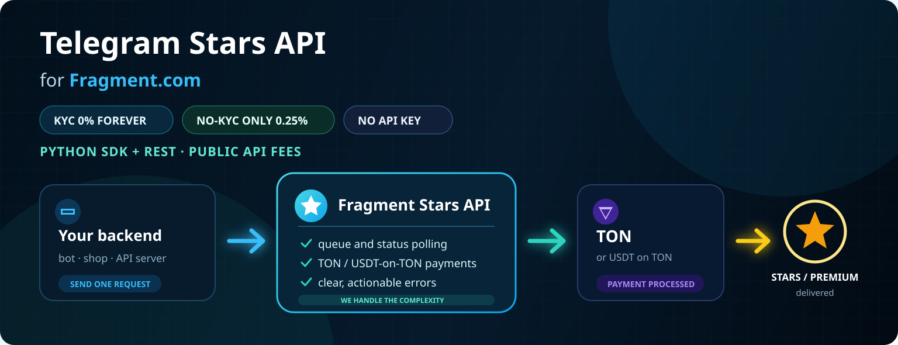

# API для покупки Telegram Stars и Premium через Fragment

## KYC 0% · БЕЗ KYC 0,25%

Покупайте Telegram Stars и дарите Premium из Telegram-бота, магазина или реселлерского backend. Python SDK или прямой REST, оплата TON и USDT в сети TON. **API-ключ не нужен.**

**Current SDK: `v2.1.6`** · **Endpoint:** `https://api.fragment-api.space`

[](https://pypi.org/project/fragment-stars-api/)
[](https://pypi.org/project/fragment-stars-api/)
[](LICENSE)

**[Быстрый старт на Python](#быстрый-старт) · [Прямой REST](docs/rest-api.md) · [Создать магазин](docs/telegram-stars-shop.md) · [English](README.md)**

### Проверка Без Кошелька

Получите текущие цены и комиссии. Эти запросы не требуют seed, cookies или токена и не создают покупку:

```bash
curl https://api.fragment-api.space/api/v1/prices
curl https://api.fragment-api.space/api/v1/commission/rates
```

KYC — **0% комиссии API навсегда**, без KYC — **0,25% комиссии API**. Стоимость Stars/Premium и расходы блокчейна оплачиваются отдельно. [Сравнение режимов и способов оплаты](docs/no-kyc-vs-kyc.md).

<p align="center">
  
</p>

> **Модель доступа:** Это независимый сервис, не официальный API Telegram или Fragment. В репозитории находятся клиентский SDK, документация и примеры, но не исходники размещённого backend. Запрос покупки передаёт seed кошелька сервису API для подписания; в KYC также передаются данные Fragment-сессии. Base64 — кодирование, не шифрование. Используйте отдельный рабочий кошелёк с ограниченным балансом. Не размещайте секреты во frontend или публичных логах. Подробнее: [SECURITY.md](SECURITY.md).

## Быстрый Старт

Установите SDK на backend:

```bash
pip install fragment-stars-api
```

Сначала выполните запрос без покупки:

```python
from fragment_api import FragmentAPIClient

with FragmentAPIClient() as client:
    print(client.get_prices())
    print(client.get_rates())
```

**Следующий пример совершает реальную покупку.** Задайте `FRAGMENT_WALLET_SEED` через хранилище секретов backend: поддерживаемый seed целиком, закодированный в Base64. Вместо `@telegram_user` укажите реального получателя.

```python
import os
from fragment_api import FragmentAPIClient

with FragmentAPIClient() as client:
    accepted = client.buy_stars(
        username="@telegram_user",
        amount=100,
        seed=os.environ["FRAGMENT_WALLET_SEED"],
        payment_method="ton",
        wait=False,
    )
    print(accepted.request_id)  # Сохраните ID рядом с заказом до опроса статуса.
```

Это **no-KYC**: cookies не переданы. Для KYC добавьте `cookies=os.environ["FRAGMENT_COOKIES"]`. Для оплаты Stars в USDT сети TON передайте `payment_method="usdt_ton"`; оставьте TON на газ и подлежащую сбору комиссию API.

Опрашивайте `client.get_status(request_id)` до финального состояния. `queued` и `processing` не подтверждают выдачу. При `wait=True` (по умолчанию) SDK опрашивает очередь сам. При таймауте или неопределённом платеже сверяйте существующий запрос, не создавайте новую покупку автоматически. [Python: интеграция и восстановление](docs/python.md).

## Выберите Интеграцию

| Задача | С чего начать |
|---|---|
| Бот на Python / aiogram / FastAPI | [Руководство Python SDK](docs/python.md) |
| Backend на Node.js / TypeScript | [Node.js и REST](docs/nodejs.md) |
| PHP, Go или другой язык | [HTTP API и примеры](docs/rest-api.md) |
| Магазин Telegram Stars | [Минимальный backend](examples/shop_minimal.py), [чеклист магазина](docs/telegram-stars-shop.md), [полный пример](https://github.com/bbbuilt/tg_stars_premium_shop) |
| Продажа Telegram Premium | [Руководство Premium API](docs/telegram-premium-api.md) |
| Интеграция с Codex, Claude или Cursor | [Codex skill](CODEX_SKILL.md) / [Claude skill](CLAUDE_SKILL.md) |

Примеры магазина — основа для разработки, а не замена авторизации покупателей, проверки оплаты и защиты от повторных заказов.

### Готовые Примеры

[KYC/no-KYC и TON/USDT](examples/payment_methods.py) · [Node.js](examples/javascript_fetch.js) · [PHP](examples/php_curl.php) · [Go](examples/go_net_http.go) · [Минимальный магазин](examples/shop_minimal.py)

## KYC И No-KYC

| Режим | Fragment cookies | Комиссия API | Способы оплаты |
|---|---|---|---|
| KYC | Собственная сессия | **0% навсегда** | TON или USDT в сети TON, где поддерживается |
| Без KYC | Не нужны | **0,25%** | Stars: TON или USDT в сети TON; Premium: TON |

Без `payment_method` сохраняется TON для совместимости. В no-KYC Stars за USDT базовая цена оплачивается в USDT, комиссия API — в TON. Комиссия накапливается по кошельку и собирается при долге **1 TON**, а не отдельным переводом при каждом заказе. Порог — не дополнительная комиссия. [Подробные правила оплаты](docs/no-kyc-vs-kyc.md).

## Выбор Кошелька

Поддерживаются 24-словная TON-мнемоника, поддерживаемый 32-байтный ключ и 12-словная BIP39-мнемоника для V5R1. Передавайте полный seed в Base64 только из backend.

- Только `seed`: для 12 слов используется `account_index=0`; старые форматы сохраняют прежний выбор версии кошелька.
- `seed + account_index`: выбор V5R1 account для 12 слов.
- `seed + wallet_address`: поиск или проверка кошелька; [пример определения индекса](examples/resolve_wallet_index.py).
- `seed + wallet_address + account_index`: проверка соответствия адреса и индекса.

Используйте `POST /api/v1/wallet/resolve`, не передавайте seed в URL. Определение адреса не означает, что средств достаточно для покупки.

## API Reference

**Основной адрес:** `https://api.fragment-api.space` — обычный HTTPS, порт `443`.

| Метод | Путь | Назначение |
|---|---|---|
| `GET` | `/health` | Доступность API |
| `GET` | `/api/v1/prices` | Цены Stars и Premium |
| `GET` | `/api/v1/commission/rates` | Комиссии API |
| `POST` | `/api/v1/stars/buy` | Покупка Stars через очередь |
| `GET` | `/api/v1/queue/{request_id}` | Статус запроса Stars |
| `POST` | `/api/v1/premium/buy` | Premium на 3, 6 или 12 месяцев |
| `POST` | `/api/v1/premium/check-eligibility` | Проверка получателя Premium |
| `POST` | `/api/v1/wallet/resolve` | Поиск или проверка account кошелька |

Клиентским запросам не нужны выданный токен, JWT, OAuth, `Authorization` или `X-API-Key`. [HTTP-примеры](docs/rest-api.md) · [Документация на сайте](https://fragment-api.space/ru/docs/).

Старые endpoints `https://api-fragment.duckdns.org` и `https://fragment-api.ydns.eu:8443` остаются совместимыми. Срочно менять работающие интеграции не требуется.

## Частые Ошибки Клиента

| Проблема | Действие |
|---|---|
| Меньше 50 Stars | Проверяйте целое количество **от 50** до начала оплаты. |
| Username без `@`, канал или бот вместо пользователя | Передавайте username личного аккаунта `@telegram_user`. |
| KYC `need_verify` | Пройдите проверку на Fragment в том же аккаунте, затем при необходимости обновите сессию. |
| Нет cookie кошелька | Подключите соответствующий кошелёк; используйте [инструкцию cookies](COOKIES_GUIDE.ru.md). |
| Таймаут или неопределённая транзакция | Сохраните `request_id`, проверьте статус и историю кошелька; не повторяйте покупку автоматически. |
| Ограничение частоты | Соблюдайте `Retry-After`; лимит no-KYC счетов — **300 на кошелёк в час**, отдельно от остальных лимитов запросов. |

[Коды ошибок и восстановление](docs/errors.md).

## Помощь И Обновления

[Помощь с интеграцией](https://github.com/bbbuilt/fragment-stars-api/issues/new?template=integration-help.yml) · [Контакт @makecodev](https://t.me/makecodev) · [Показать свой магазин](https://github.com/bbbuilt/fragment-stars-api/discussions/2)

[Релизы SDK](https://github.com/bbbuilt/fragment-stars-api/releases) · [Changelog SDK](CHANGELOG.md) · [Публичные изменения сервиса](docs/service-updates.md) · [Документация для AI](https://fragment-api.space/llms.txt)

**LIKE IT? STAR IT!** Звезда помогает разработчикам находить проект. Обратная связь по интеграции и реальные примеры магазинов приветствуются.

## Участие И Лицензия

Проект поддерживает [bbbuilt](https://github.com/bbbuilt). Правила: [CONTRIBUTING.md](CONTRIBUTING.md) и [SECURITY.md](SECURITY.md). Не публикуйте seed, cookies, приватные ключи или данные клиентов в issues.

Клиентский код и примеры распространяются под [MIT License](LICENSE). Это не лицензия на размещённый backend и не заявление об аффилированности с Telegram или Fragment.
